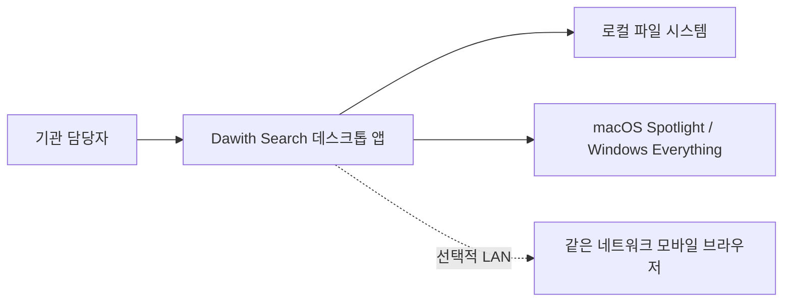
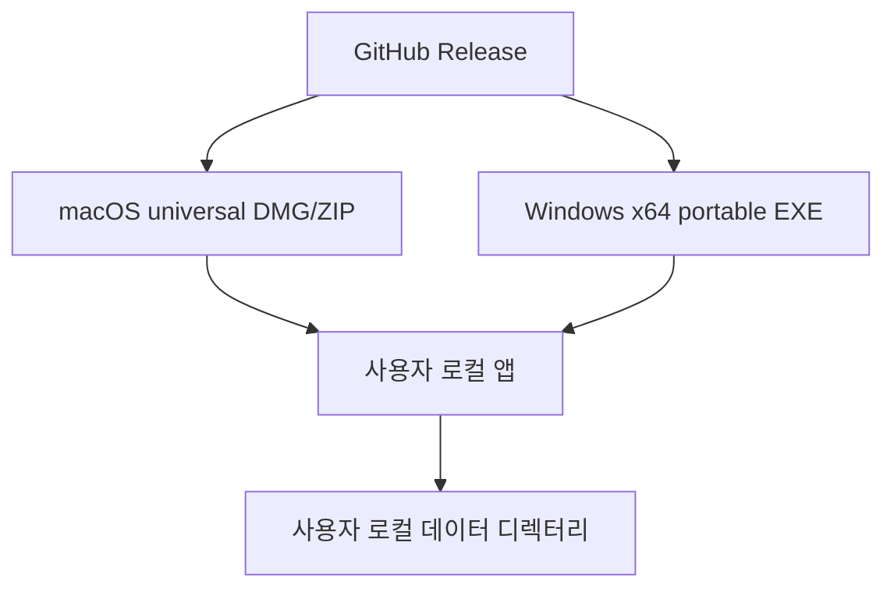

# Architecture: Dawith Search

## 0. Links

- Product and operations: [README.md](./README.md), [OPERATIONS.md](./OPERATIONS.md)
- Runtime entry: `src/main/main.js`
- Renderer bridge: `src/main/preload.js`

## 1. System Context

사용자 파일과 검색 인덱스는 로컬에 보관한다. 외부 AI와 외부 검색 API는 사용하지 않는다.

## 2. Container View

| 컨테이너 | 책임 | 기술 |
| --- | --- | --- |
| Electron main | 창 수명주기, IPC, 파일 작업, 트레이, 원격 서버 | Electron 45.x, Node.js |
| Local indexer | 색인·캐시·감시·쿼리 실행 | fdir 6.x, chokidar 3.x |
| Native adapter | 플랫폼별 빠른 검색 | macOS `mdfind`, Windows Voidtools `es.exe` |
| Renderer | 검색 작업대·기관 업무 UX·안내 | HTML/CSS/브라우저 JS |
| Remote server | 토큰으로 보호된 선택적 모바일 검색 | Express 4.x, Node HTTP |

## 3. Component View

- `Indexer`: 검색 루트, 색인, 파일 감시, 네이티브 검색 결과의 루트 제한
- `QueryParser`: Everything 계열 문법과 로컬 규칙 기반 자연어 보조
- `NativeSearchAdapter`: Spotlight/Everything adapter와 레코드 정규화
- `storage-utils`: 원자적 JSON 저장, 백업 복구, 로컬 권한 설정
- `RemoteServer`: 토큰 인증, 요청 제한, 검색 루트 realpath allowlist
- `main.js`: single-instance, crash logging, IPC 경로 경계
- `renderer/app.js`: 검색 작업대, 저장 검색, Quick Look, 안전한 파일 작업

## 4. Data Design

로컬 데이터 디렉터리 `~/.dawith-search`에 다음 파일을 둔다.

| 파일 | 내용 | 복구 |
| --- | --- | --- |
| `config.json` | 검색 루트·제외 규칙·백엔드 선택 | `config.json.bak` |
| `index-cache.json` | 색인된 파일 레코드 | `index-cache.json.bak` 또는 전체 재색인 |
| `metadata.json` | 태그·별표 | `metadata.json.bak` |
| `bookmarks.json` | 저장 검색 | `bookmarks.json.bak` |
| `search-history.json` | 최근 검색 | `search-history.json.bak` |

모든 JSON 쓰기는 임시 파일 → rename 순서로 수행한다. 파일에는 운영체제별로 가능한 최소 권한을 적용한다.

## 5. Interface Design

Renderer와 main 사이 IPC는 preload에서 명시적으로 노출한다. 파일 관련 IPC는 `Indexer.isWithinConfiguredRoot()`를 통과한 경로만 처리한다.

모바일 원격 서버의 공개 표면:

- `GET /?token=...`: 토큰 확인 후 HttpOnly 쿠키 발급
- `GET /api/search?q=...`: 인증된 로컬 색인 검색
- `GET /api/download?path=...`: 허용 루트 내부의 일반 파일만 다운로드
- `GET /api/preview?path=...`: 허용 루트 내부의 일반 파일만 미리보기

## 6. NFR Realization

- 성능: OS native index → local index fallback, 검색 결과 상한, 디바운스 검색
- 보안: context isolation, nodeIntegration 비활성화, CSP, token auth, path allowlist
- 개인정보: 외부 AI/API 미사용, 로컬 저장소, 원격 기능 명시적 시작
- 복구: atomic write, backup recovery, reindex, crash log
- 접근성: 키보드 탐색, visible focus, reduced motion, 명확한 empty/error state

## 7. Product ADRs

### ADR-001 — 플랫폼별 native adapter + 공통 local fallback

- Status: Accepted
- Context: macOS와 Windows의 검색 인덱스 계약이 다르다.
- Decision: 단순 쿼리는 OS adapter를 사용하되, Everything 전용 조건·태그·본문·범위 조건은 공통 local parser/indexer를 사용한다.
- Alternatives rejected: 플랫폼별 기능을 완전히 분리하면 UX와 회귀 검증이 달라진다.
- Consequences: 백엔드 상태를 UI에 표시하고, native 결과도 검색 루트로 제한한다.

### ADR-002 — 선택적 LAN 원격 기능은 ephemeral token으로 보호

- Status: Accepted
- Context: 모바일 공유는 편리하지만 인증 없는 파일 다운로드는 기관 환경에서 허용할 수 없다.
- Decision: 시작마다 랜덤 토큰을 발급하고 HttpOnly/SameSite 쿠키와 root realpath allowlist를 적용한다.
- Alternatives rejected: IP allowlist만으로는 동일 네트워크의 다른 사용자를 구분하지 못한다.
- Consequences: QR URL을 공유받은 사용자만 30분 세션 동안 접근한다.

## 8. Deployment View

릴리스는 GitHub Actions의 세 OS 검증과 macOS/Windows 패키징을 통과해야 한다. 코드 서명 인증서가 없는 빌드는 첫 실행 보안 안내를 제공한다.

## 9. Risks & Tech Debt

- 코드 서명·자동 업데이트는 인증서와 배포 정책이 필요하다.
- 대규모 기관 공유 드라이브는 OS 권한과 색인 시간에 따라 별도 부하 테스트가 필요하다.
- 원격 서버는 LAN 전용 보조 기능이며 중앙 인증·감사 로그가 필요한 조직은 사용하지 않아야 한다.
- Windows의 Everything native backend는 Voidtools 설치·서비스 상태에 의존하며 미설치 시 local fallback을 사용한다.
